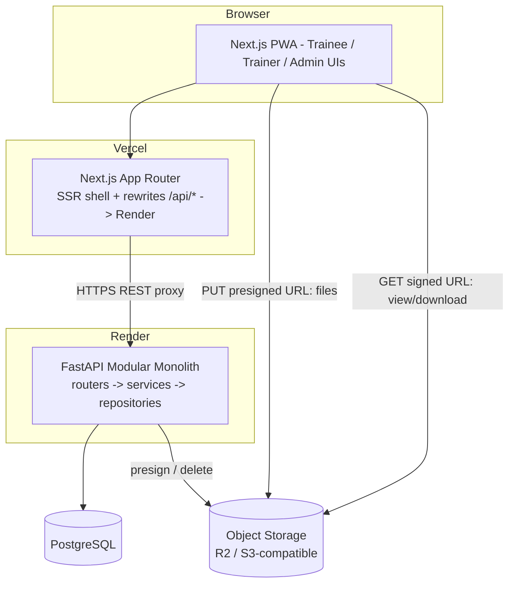

# System Architecture

## Architecture Diagram



## Backend Layering
```
HTTP router (thin) -> service (business rules, transactions) -> models (SQLAlchemy)
                    -> schemas (Pydantic in/out) -> dependencies (auth, RBAC, DB session, pagination)
```

## State Machines
- **User.status:** `pending` -> `active` | `rejected` ; `active` -> `suspended` -> `active`
- **Course.status:** `draft` -> `pending_review` (optional) -> `published` -> `archived`
- **Enrollment.status:** `enrolled` -> `in_progress` -> `completed` | `dropped`
- **Attempt.status:** `in_progress` -> `submitted` (auto-submit at deadline/time limit)
- **Certificate.status:** `issued` -> `revoked`
